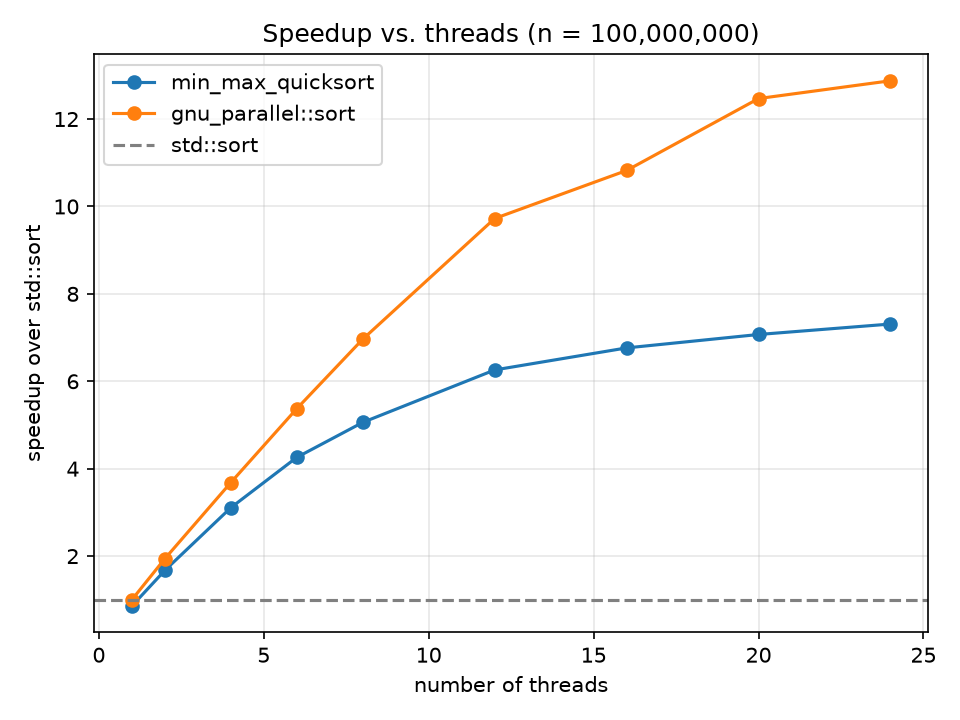
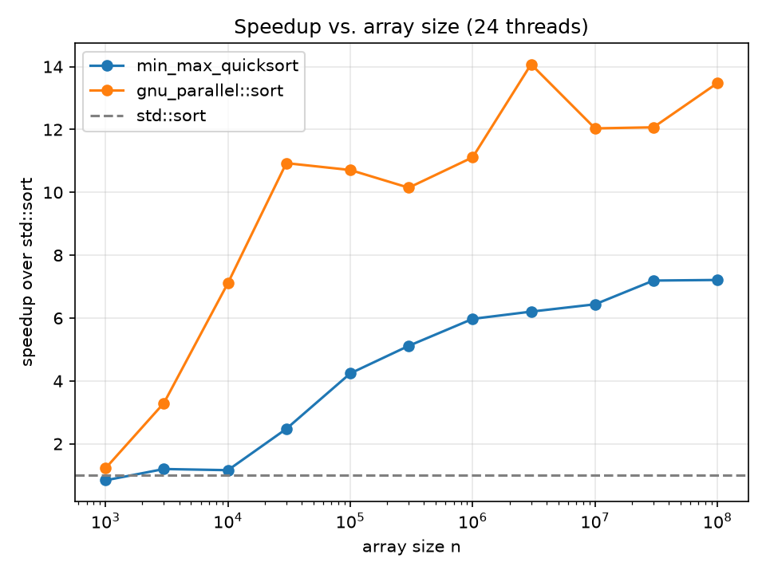

# Lecture 04 – Tasks, Merge Sort and Paper

## Task 1: Benchmark `min_max_quicksort`

Code: [`task1/min_max_quicksort.cpp`](task1/min_max_quicksort.cpp) (sorting code unchanged, `main` replaced by a benchmark driver), plots: [`task1/plot.py`](task1/plot.py), raw data: [`task1/threads.csv`](task1/threads.csv), [`task1/sizes.csv`](task1/sizes.csv)

Benchmarking environment:
- OS: Linux 7.2.10 (CachyOS)
- CPU: AMD Ryzen 9 7900, 12 cores / 24 threads (SMT)
- RAM: 62 GiB, L3 cache 64 MiB
- Compiler: GCC 16.2.1, `g++ -O3 -std=c++17 -march=native -fopenmp`

Method: array of random `int64_t` (xoroshiro128+), median of repeated runs (5 runs for n = 10^8, up to 101 for small n). Every repetition sorts different random data (the same for all three algorithms); the first run of each algorithm is checked against `std::sort`. Array generation is not timed. `omp_set_num_threads(t)` sets the thread count for `min_max_quicksort` and `__gnu_parallel::sort`; `std::sort` is sequential.

Run: `./a.out threads 100000000 > threads.csv`, `./a.out sizes > sizes.csv`, `python3 plot.py threads.csv sizes.csv`.

Note: the n = 1000 row of `sizes.csv` was measured again on its own, because in the sweep it was the first measurement of the program and was disturbed once (3.2 ms instead of 39 µs for `min_max_quicksort`, not reproducible in 3 separate runs).

Speedup over threads (n = 10^8): `std::sort` needs 7.39 s. With one thread `min_max_quicksort` is slower (8.6 s, speedup 0.86), `__gnu_parallel::sort` is as fast as `std::sort`. Both get faster almost linearly up to 4 threads (3.1× and 3.7×), after that the curves bend. With 12 threads, the number of physical cores, the speedups are 6.3× and 9.7×. The 12 extra threads on the SMT siblings add only little (7.3× and 12.9× with 24 threads). Possible reasons for the flattening are that the threads share physical cores and that sorting 800 MB is probably limited by memory bandwidth (not measured). `__gnu_parallel::sort` is faster than `min_max_quicksort` for every thread count above 1 and scales further. One reason could be that `min_max_quicksort` has to partition the whole array in one thread before the first tasks can start, while `__gnu_parallel::sort` (I think a multiway mergesort, not checked) sorts chunks in parallel from the beginning.

Speedup over array size (24 threads): for small arrays the speedup is small or below 1. For n = 1000, `std::sort` needs about 33 µs and `min_max_quicksort` about 39 µs, so starting the threads and creating the tasks costs as much as the sorting itself. `__gnu_parallel::sort` is already 3.3× faster at n = 3000 and 7.1× at n = 10^4, `min_max_quicksort` needs about n = 10^5 for 4.2×. After that the speedups grow slowly and flatten at about 7.2× (`min_max_quicksort`) and 12–14× (`__gnu_parallel::sort`). The values of `__gnu_parallel::sort` between 3·10^4 and 10^8 vary by about ±2× without a clear trend (14.1 at 3·10^6, 12.0 at 10^7), so I do not read a trend into these differences. A speedup above 12 on 12 physical cores is possible because of SMT, and probably also because the chunks per thread fit better into the caches (not measured).

## Task 2: What every systems programmer should know about concurrency

I chose two points from the paper: the cache effects of a readers-writer lock and the meaning of `volatile`.

### Cache effects of a readers-writer lock
A readers-writer lock lets any number of readers or one writer into the critical section. Readers take the lock with an atomic read-modify-write operation on a shared counter. This looks cheap, because no reader blocks another one. But every one of these operations needs the cache line with the counter. If the readers run on different cores, the line moves from cache to cache for every single lock call ("ping-pong"), and this can take longer than the critical section itself, even though nobody has to wait. The paper adds that a cache miss can cost much more than an atomic operation. The same happens to unrelated variables that lie on the same cache line, which is the false sharing from Lecture 2. Padding the variables with a cache line avoids it, but costs memory. I find this interesting because the readers do not block each other and are still slowed down, so not blocking is not the same as being fast.

### `volatile` is not a tool for concurrency
`volatile` is often used as if it made a variable safe to share between threads. The paper explains that in C and C++ it does only two things: the compiler may not remove loads and stores that look unnecessary, and it may not reorder volatile accesses with other volatile ones. This is meant for memory-mapped I/O, where every write to an address has an effect on a device. It gives no atomicity and no memory barriers on weakly-ordered hardware like ARM, and the compiler may still move normal reads and writes around volatile ones. So it only works if neither the compiler nor the hardware reorders anything. The paper says the misconception probably comes from Java and C#, where `volatile` does enforce ordering. This is interesting because `volatile` looks like the obvious tool for a stop flag between threads, but the right tool is `std::atomic`, and for such a flag even `memory_order_relaxed` is enough.

**Source:**
- M. Kline, *What every systems programmer should know about concurrency*, April 28, 2020. https://assets.bitbashing.io/papers/concurrency-primer.pdf
